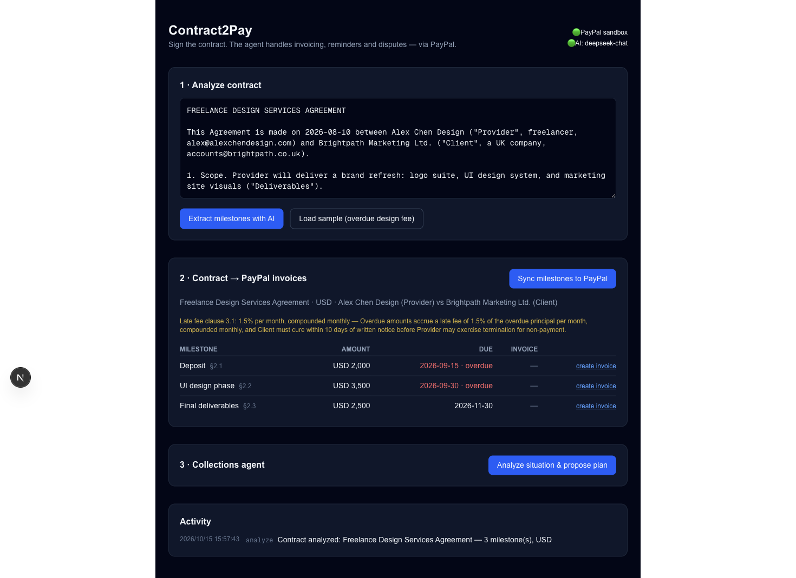
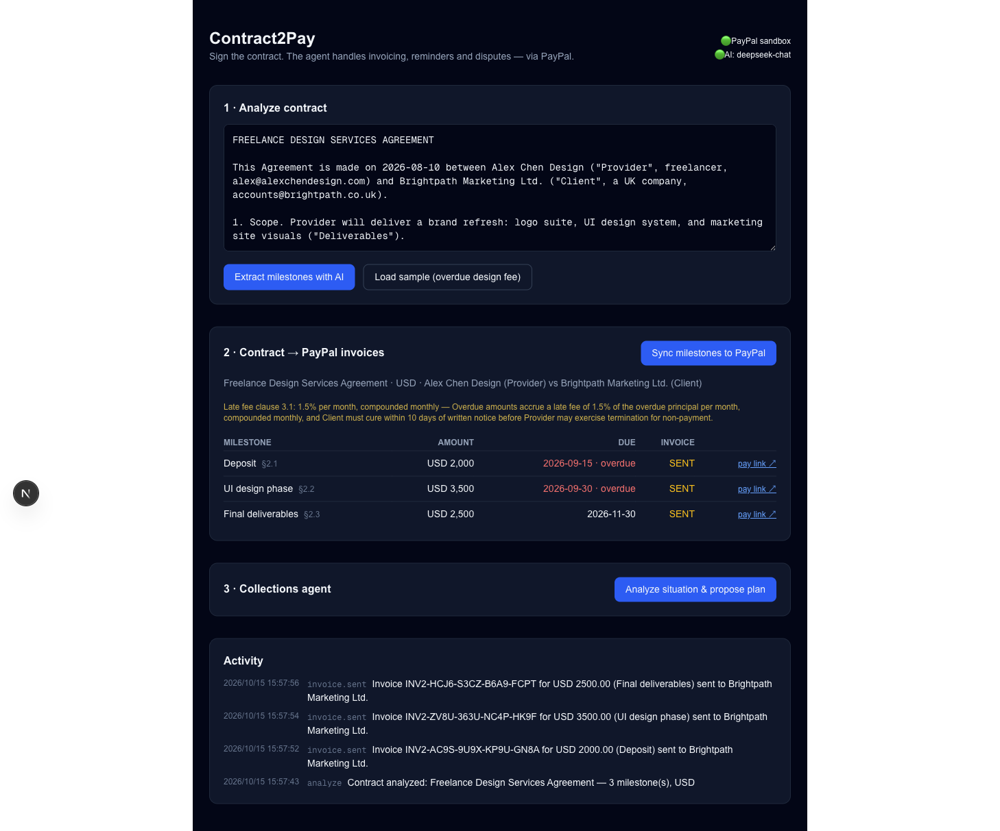
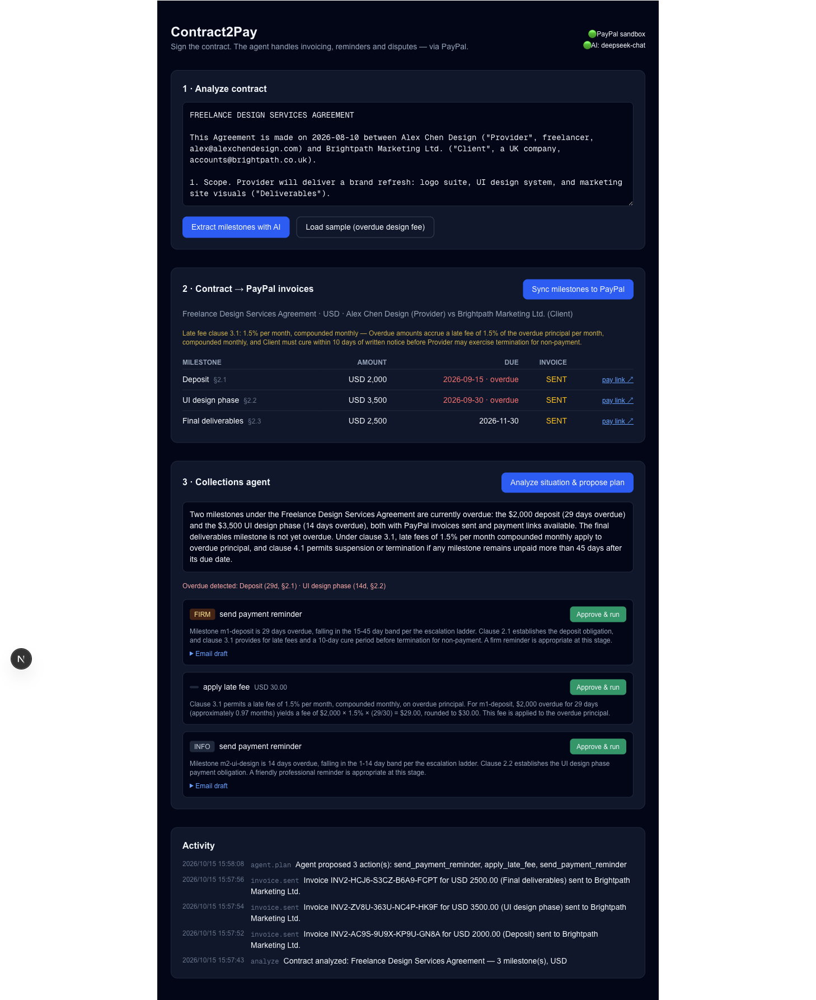

# Contract2Pay

**From signed contract to settled invoice — an AI collections agent on PayPal.**

Cross-border freelancers and small studios lose weeks chasing payments. Contract2Pay closes the
loop: an AI agent reads the signed contract, turns its payment milestones into real PayPal
invoices, watches their live status, and — when a client runs late — builds an escalation plan
(reminder → contractually-cited late fee → dispute evidence pack) that the owner approves with
one click.

## How it works

```
Contract text ──► AI extraction ──► PayPal Invoicing API v2 (create + send hosted invoices)
                                        │
                 Webhooks ◄──────────────┘  (INVOICING.INVOICE.PAID / CANCELLED / …)
                    │
                    ▼
             Collections agent (LLM + hard facts)
             facts computed server-side: days overdue, invoice status, clause refs
                    │
                    ▼
             Human-in-the-loop plan: [remind] [late fee invoice] [dispute pack]
                     each action executes through PayPal REST APIs after approval
```

- **AI**: contract → structured billing facts (milestones, amounts, due dates, late-fee and
  dispute clauses with exact clause references); situation analysis; escalation plans with
  rationale citing clauses; payment-reminder email drafts. Any OpenAI-compatible endpoint
  (Gemini / GLM / OpenAI …) — provider-agnostic via env.
- **PayPal** (all real REST calls, sandbox): OAuth2 client-credentials, Invoicing v2
  (create / send / status / hosted pay links), late-fee invoices as second invoices, webhook
  receiver with signature verification, Orders v2 + refunds available in `src/lib/paypal.ts`.
- **Agent design**: the LLM never invents facts. Days-overdue, amounts and invoice states are
  computed server-side from contract + live PayPal data and handed to the model as JSON; the
  model only analyzes and plans; every action requires explicit user approval before execution
  (human-in-the-loop), and reminders only cite remedies that actually exist in the contract.

## Demo scenario (30-second version)

1. Load the built-in sample: a design-services contract with a milestone already overdue.
2. "Extract milestones" → AI returns 3 milestones with clause refs (§2.1–2.3) + late-fee clause §3.1.
3. "Sync milestones to PayPal" → real sandbox invoices created & sent, hosted pay links appear.
4. "Analyze situation & propose plan" → agent detects the overdue milestone, proposes:
   a firm reminder (email drafted, citing §3.1 and the pay link) + a 1.5%/month late-fee
   invoice computed from elapsed months.
5. Approve each action → PayPal invoice for the late fee is actually created; reminder email
   is recorded; activity log shows the full audit trail.

## Screenshots

| Analyze | Invoices | Agent plan |
|---|---|---|
|  |  |  |

## Run it

```bash
cp .env.example .env.local   # fill in PayPal sandbox keys + any OpenAI-compatible AI endpoint
npm install
npm run dev                  # http://localhost:3000
```

PayPal sandbox keys: [developer.paypal.com/dashboard/applications/sandbox](https://developer.paypal.com/dashboard/applications/sandbox)
→ create a REST app → copy Client ID / Secret. Optional: add a webhook and set
`PAYPAL_WEBHOOK_ID` to enforce signature verification on `/api/webhooks/paypal`
(sandbox events can also be fired from the dashboard's webhook simulator).

Judges: complete setup instructions are this section; everything runs against the free PayPal
sandbox, no other external accounts required.

## Tech

Next.js (App Router, TypeScript) · Tailwind CSS · PayPal REST v2 (no SDK — transparent calls in
`src/lib/paypal.ts`) · JSON-file persistence (demo store, swappable) · provider-agnostic LLM
layer (`src/lib/ai.ts`).

## Notes

Contract2Pay is a payment-workflow assistant, not legal advice; it only acts on clauses that
exist in the user's own contract and requires human approval for every outbound action.

## License

MIT — see [LICENSE](LICENSE).
